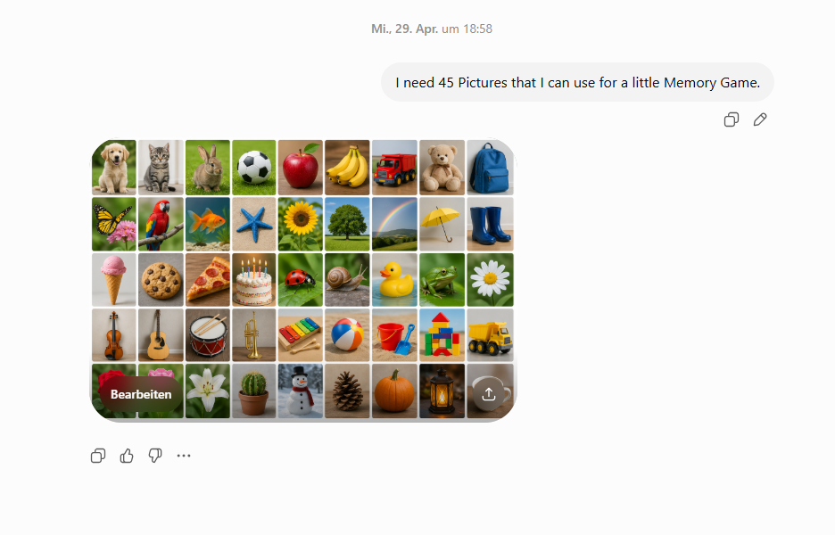

## AI-Usage
* FXML indentation
  * With the usage of SceneBuilder the indentations are sometimes all over the place and thereby the fxml is hard to read.
  * The cleanup takes a long time if you do it yourself. LLMs are just faster and the time you get by not having to care about the cleanup can be used for more relevant (coding) stuff

* CSS-Color Schemes
  * While I try my best to find matching color combinations the AI has more information about matching colors.
  * With the help of AI the UI has a good-looking color scheme

* Help with Bugfixes
  * While for some Bugs it's easy to pinpoint why and where they happen this is not the case for all. In those cases where I was not able to pinpoint the reason for a Bug or why the Bug occurred LLMs can sometimes help.

* Creation of Java Docs
  * Since we neglected the documentation of our code during development we had a lot of uncommented code. LLMs are a 
    good tool to create this documentation in a fast manner. The Comments still had to be reevaluated by myself for 
    correctness

* Creation of Images
  * Sadly time is a limiting factor in the creation of Icons. In an ideal world the images of Memory and the Icons 
    of the Tetris Game would have been all created by myself. For Memory I started taking photos of the university 
    but due to limited time I had to ask ChatGPT for Images.
    
  * The same goes for the Icons of Tetris. There I only had time to create the Bomb Icons, the Poral and the swaps. 
    All the other Icons had to be created with the usage of ChatGPT since there was just to little time to get creative.